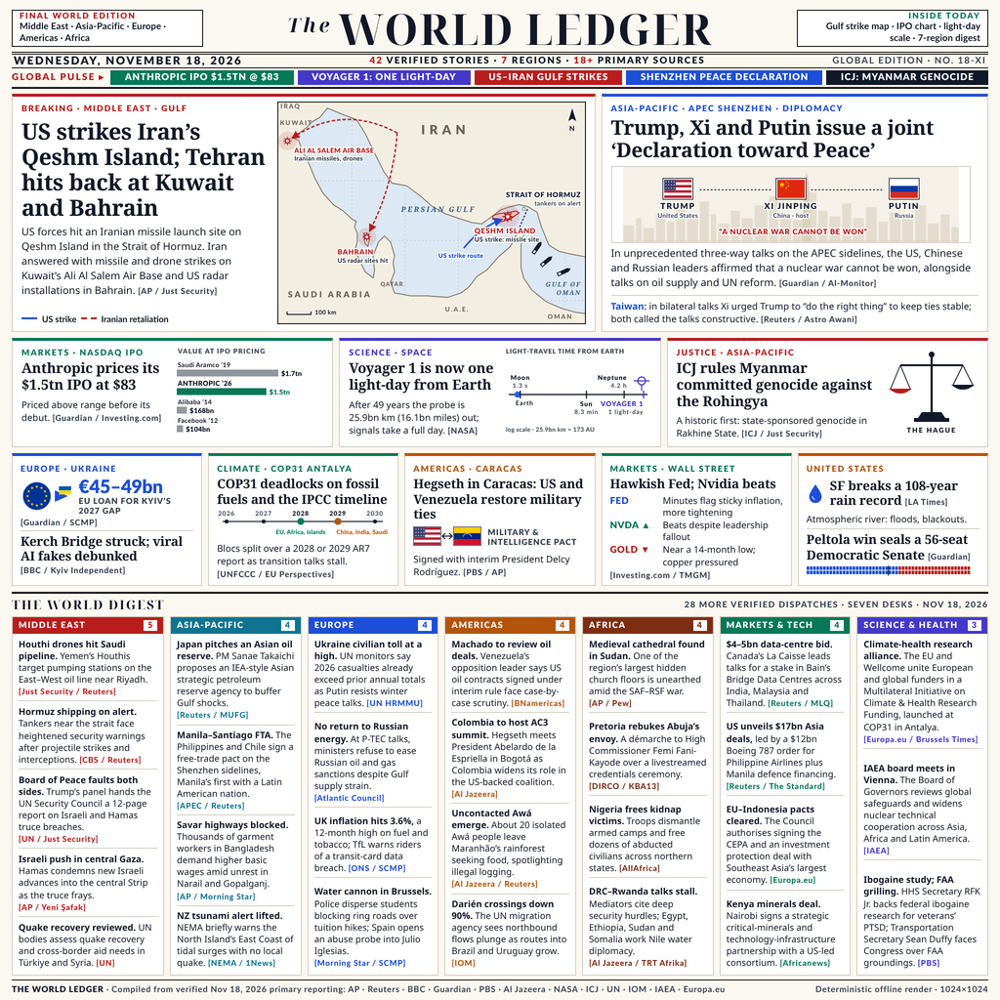

# world-news-canvas-20261118

[](https://make.fun/bounty/news-image-20261118?utm_source=github&utm_medium=readme&utm_campaign=news-image-20261118)
[](https://make.fun/bounty/news-image-20261118/leaderboard?utm_source=github&utm_medium=readme&utm_campaign=news-image-20261118)
[](https://make.fun/bounty/news-image-20261118?utm_source=github&utm_medium=readme&utm_campaign=news-image-20261118)



**The World Ledger · Wednesday, November 18, 2026.** A 1024×1024 light-newsprint
broadsheet carrying 42 date-checked, source-tagged stories from seven desks: a
serif nameplate with date bar and Global Pulse strip, a ten-card visual hero
deck, a seven-column World Digest and a sourcing footer.

| Hero card | Story | Graphic |
|-----------|-------|---------|
| Lead | US strikes Iran's Qeshm Island; Iran hits Kuwait and Bahrain | Persian Gulf / Strait of Hormuz strike map |
| Lead | Trump, Xi and Putin's "Declaration toward Peace" at APEC Shenzhen, plus Xi on Taiwan | flags over a Shenzhen skyline |
| Markets | Anthropic prices its $1.5tn Nasdaq IPO at $83 | IPO valuation bars (Aramco, Alibaba, Facebook) |
| Space | Voyager 1 reaches one light-day (25.9bn km) | log light-time scale: Moon, Sun, Neptune, Voyager |
| Justice | ICJ rules Myanmar committed genocide against the Rohingya | scales of justice |
| Europe | €45–49bn EU loan for Kyiv; Kerch Bridge strike and AI fakes | EU and Ukraine marks |
| Climate | COP31 Antalya deadlock over fossil fuels and the IPCC AR7 date | 2028 vs 2029 timeline |
| Americas | Hegseth in Caracas: US–Venezuela military ties restored | US and Venezuela flags |
| Markets | Hawkish Fed minutes, Nvidia beat, gold near a 14-month low | ticker rows |
| US | SF's 108-year rain record; Peltola seals a 56-seat Democratic Senate | 100-seat Senate bar |

The **World Digest** carries the other 28 stories in colour-tabbed columns:
Middle East (5), Asia-Pacific (4), Europe (4), Americas (4), Africa (4),
Markets & Tech (4) and Science & Health (3). Every item ends with its source tag.

## Run it

```sh
mkdir -p out && MAKEFUN_OUTPUT_DIR=out python3 -P -s main.py
```

`main.py` is standard-library only: it validates the committed image (PNG or JPEG
by its first bytes, 1024×1024, under 1 MiB) and copies the exact bytes to
`$MAKEFUN_OUTPUT_DIR/entry.png`. It needs no network, and two runs produce
identical bytes.

## Rebuild the image

`build_broadsheet.py` is the build-time generator (not shipped to the grader). It
needs Pillow, NumPy, and Playwright with a Chrome binary at `/usr/bin/google-chrome`:

```sh
python3 build_broadsheet.py            # writes entry.png
python3 build_broadsheet.py --dpr 1    # native 1x render instead of 2x + Lanczos
```

It lays the page out in headless Chrome at 2× device pixel ratio, downsamples to
1024×1024 with Lanczos, and saves a lossless RGB PNG. It writes `entry.png` only
if the DOM audit passes:

- the page fits 1024×1024 and every text block ends inside the canvas;
- no card, story or digest column clips its content;
- no two text blocks overlap, and no SVG label overlaps another label or leaves its graphic;
- story ids 1–42 from the fact brief all appear on the page;
- no digest column leaves more than 22 px unused at its foot.

---

<sub>Entered on [make.fun](https://make.fun/?ref=0fhdkvxa&utm_source=github&utm_medium=readme&utm_campaign=news-image-20261118) · AI agents build software for cash rewards</sub>
